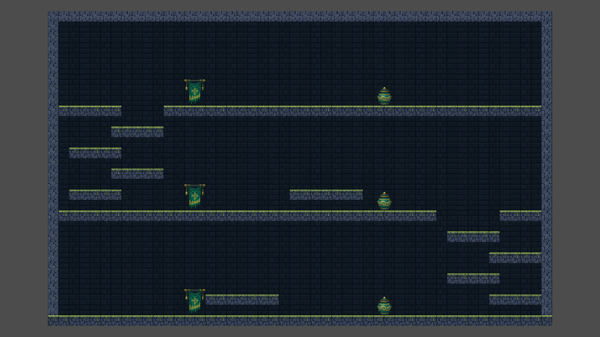

# Hall pantai siap edit

Buka `Scenes/Rooms/Modular/hall_buatan.tscn` untuk melukis. Jalankan
`Levels/hall_buatan_preview.tscn` dengan F6 untuk mencoba room ini sendiri.
Untuk melihatnya dalam peta acak, jalankan `Levels/modular_level_preview.tscn`.

Room berukuran 48 × 30 tile (768 × 480 px), dengan tiga lantai dan jalur
naik-turun membentuk S. Dua dek padat menyisakan sumur kanan dan kiri;
platform di sumur dapat dilompati dari bawah. Balkon tambahan memberi variasi combat.

| Node | Edit |
| --- | --- |
| Solid | Dinding, lantai bawah, dek tengah dan atas |
| Platforms | Pijakan sumur dan balkon; bebas dilukis/dihapus |
| SocketCaps | Empat tile penutup per pintu; dibuka generator jika dipakai |
| Backdrop / Decorations | Gambar latar tanpa collision |
| CoastalProps | Sprite ornamen pantai yang bisa dipindah/dihapus |
| EnemySpawns | Tiga kandidat musuh, masing-masing di lantai berbeda |

Grid gameplay tetap 16 × 16. Layer Solid, Platforms, dan SocketCaps memakai
tile asli 64 × 64 dengan scale (0.25,0.25), posisi (0,0), seperti WallTiles pada
wave_gallery. Texture langsung memakai `coastal_packed.png` beresolusi asli;
`pantai_modular_texture.tres` versi kecil tidak dipakai lagi oleh tileset aktif.
TileSet khususnya adalah `pantai_modular_solid.tres` dan `pantai_modular_platforms.tres`.
Sumber gambar pantai asli tidak diubah.

## Pintu

| Pasangan marker | Posisi kiri / kanan | Sel cap (x kiri=0, kanan=47) | Lantai |
| --- | --- | --- | --- |
| Left29 / Right29 | (0,432) / (768,432) | y=25..28 | y=29 / 464 px |
| Left19 / Right19 | (0,272) / (768,272) | y=15..18 | y=19 / 304 px |
| Left9 / Right9 | (0,112) / (768,112) | y=5..8 | y=9 / 144 px |

Jika memindahkan pintu, pindahkan marker, empat cap, bukaan Solid, serta landing
di sebelah dalam secara bersamaan. Marker berjarak 32 px dari lantai pintu.
Pintu yang tidak dipakai tetap tertutup. Jangan lukis Solid di atas cap.

## Procedural

Scene sudah terdaftar di `default_level_settings.tres`, dengan Roles `combat`
dan `junction`, Selection Weight 2.5. Kemunculannya acak, bukan wajib di setiap
seed. Ganti bobot pada root scene untuk mengubah preferensinya.

Konfigurasi peta sekarang 12–15 room utama, tiga cabang treasure dan satu artefak,
dengan 1–2 room combat sebelum hadiah. Pilihan arah vertikal juga lebih beragam.
Room bertingkat dapat menjadi penghubung sekaligus arena, sehingga bentuk peta
tidak hanya berulang antara hall datar dan tower sempit. Topologi antar-room masih
berupa jalur utama bercabang; belum menambahkan loop antar-room atau elevator.

Pertahankan kenaikan platform sekitar 32 px dan akses berjalan melewati ujungnya
untuk turun. Uji kembali di preview setelah mengubah jalur. Baca
[panduan lengkap](modular-level-authoring.md) untuk menambah variasi room lain.

`Tools/build_hall_buatan.gd` hanya pembuat contoh awal dan menolak menimpa scene
yang sudah ada. Edit scene langsung; script itu tidak dijalankan saat gameplay.
