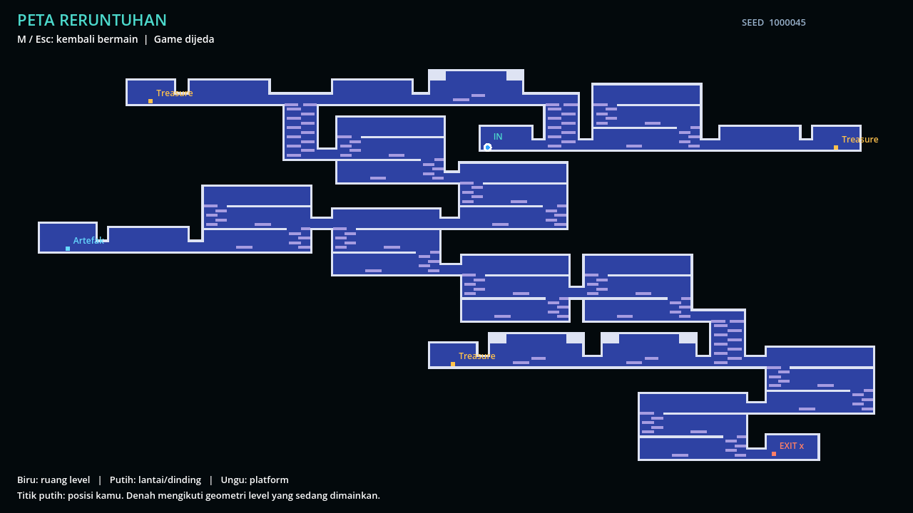

# Level modular: room buatan tangan + generator

**Update atlas pantai:** Solid, Platforms, dan SocketCaps seluruh katalog aktif
sekarang memakai atlas asli 64px `coastal_packed.png`, dengan scale layer 0.25.
Satu sel tetap 16px di dunia game. Pertahankan scale tersebut ketika melukis.
Backdrop/Decorations lama tetap 16px dengan scale 1. Petunjuk TileSet 16px di
bawah berlaku untuk membuat tileset baru, bukan mengubah scale atlas pantai ini.

Contoh pantai tiga lantai siap edit: [hall_buatan](hall-buatan.md).
Scene ini sudah masuk katalog procedural dan memiliki preview bermain sendiri.

Sistem aktif untuk seluruh node combat di `Levels/stage_graph_template.tscn`
sekarang menggunakan `Scenes/Rooms/Modular/modular_level.tscn`.
`Levels/room_1_preview.tscn` juga mengikuti sistem ini. Urutan antar-stage
(safe, combat, elite, boss) tetap diatur `Script/Stage/stage_graph.gd`.

Pendekatannya mengikuti [contoh Edgar](https://ondrejnepozitek.github.io/Edgar-Unity/docs/examples/dead-cells/)
dan [penjelasan desain Dead Cells oleh Motion Twin](https://www.moddb.com/news/the-level-design-of-a-procedurally-generated-metroidvania):
ruang dirancang terlebih dahulu, graph menentukan fungsi/jalur, lalu generator
memilih variasi dan menyambungkan pintu yang cocok. Ini implementasi Godot sendiri,
tanpa dependensi Edgar/Unity. Grafik bawaan adalah contoh dari aset proyek.

## Langsung mencoba

1. Buka `Levels/modular_level_preview.tscn`, lalu **F6**. Seed run contoh: **42**.
2. Tekan **M** untuk peta, **M/Esc** untuk kembali. Peta menampilkan lantai,
   dinding, platform, treasure, artefak, spawn, dan exit dari tile level.
3. Cabang treasure memberi 5 koin lewat **E**. Cabang artefak membuka entri
   katalog artefak lewat **E**; belum menambahkan efek equipment/stat baru.
4. Exit terbuka setelah musuh level selesai dikalahkan. Cabang hadiah opsional.
5. Untuk seed baru, ubah `Random Seed` pada root preview; **0** berarti acak.
   Seed pada peta adalah seed combat turunan dari seed run, sehingga setiap
   combat dalam satu run berbeda tetapi run yang sama dapat direproduksi.

## Menggambar room sendiri

Buka salah satu contoh ini di editor 2D, kemudian edit langsung layer TileMap-nya:

| Scene di `Scenes/Rooms/Modular/` | Peran |
| --- | --- |
| `entrance.tscn` | Spawn awal |
| `hall.tscn` | Koridor combat |
| `long_gallery.tscn` | Ruang memanjang dengan plafon bertingkat |
| `vaulted_hall.tscn` | Ruang tinggi dan balkon |
| `tower.tscn` | Penghubung vertikal, 4 pintu |
| `short_tower.tscn` | Variasi penghubung vertikal |
| `treasure.tscn` | Ujung cabang peti |
| `artifact.tscn` | Ujung cabang artefak |
| `exit.tscn` | Pintu ke node stage berikutnya |

Semua room adalah **scene tersimpan**, bukan hasil lukisan ulang script saat game
berjalan. Generator menginstansiasi scene, memindahkannya tanpa scale/rotasi,
dan hanya membuka empat tile `SocketCaps` untuk pintu yang digunakan.

| Node | Cara mengedit |
| --- | --- |
| `Solid` | Gambar lantai, dinding, plafon. Tile mempunyai collision Ground penuh. |
| `Platforms` | Gambar pijakan yang bisa dilompati dari bawah. Collision one-way. |
| `Backdrop` | Background room; collision dimatikan. |
| `Decorations` | Ornamen visual; collision dimatikan. Boleh menambah Sprite2D. |
| `SocketCaps` | Penutup pintu yang tidak digunakan; jangan dipakai menggambar area lain. |
| `Sockets` | Marker pintu dengan arah kiri/kanan. Panah hanya terlihat di editor. |
| `PlayerSpawn`, `RewardSpawn` | Marker 32 px di atas permukaan pijakan. |
| `EnemySpawns` | Tambahkan Marker2D untuk kandidat spawn musuh. |

Gunakan grid **16 × 16**, posisi layer **(0,0)** dan scale **(1,1)**.
`modular_solid.tres` dan `modular_platforms.tres` menggunakan atlas
`Assets/Tileset/Sprites/coastal_ruins.png` dengan ukuran asli 16 px per tile.
Ganti/gambar ulang PNG tersebut untuk mengganti skin bersama, atau buat TileSet
16 px sendiri. Tile collision memakai polygon persegi penuh dari (-8,-8) ke
(8,8), physics layer **Ground (2)**; platform juga memakai **One Way**.
Versi ini memvalidasi blok penuh, belum mendukung slope/polygon collision bebas.
Jika membuat skin terpisah, pakai **Make Unique** agar resource shared tidak ikut berubah.

Lukisan `Solid`, `Platforms`, `Backdrop`, dan `Decorations` tidak dipotong,
di-stretch, atau diganti generator. Collision dan peta dibaca dari tile yang sama.
Jangan menambah StaticBody2D tersembunyi atau collision ke dekorasi; jalur navigasi
generator membaca layer collision di atas.

## Menambah template ke pilihan acak

1. Duplikat scene contoh dengan **Save As** ke nama baru.
2. Ubah `Room Id` menjadi unik; pilih `Roles`: `entrance`, `combat`, `junction`,
   `treasure`, `artifact`, atau `exit`.
3. Atur `Size In Tiles` pada root sesuai batas room; lukis semua tile di dalamnya.
4. Gambar lantai/plafon/dinding penutup di seluruh tepi. Bentuk ruang di dalam
   batas boleh diubah, termasuk plafon bertingkat dan alcove.
5. Untuk setiap socket, letakkan marker di x=0 atau x=`Size In Tiles.x * 16`.
   y adalah pusat bukaan 64 px. Lantai pintu berada di **y marker + 32**.
   Isi 4 sel tepi pintu dengan `SocketCaps`, kosongkan `Solid` di 4 sel tersebut,
   dan sisakan landing di sebelah dalam. Jangan menggambar Solid menutup socket.
6. Room `junction` membutuhkan pintu kiri/kanan pada **dua ketinggian berbeda**.
   Jalur utama menggunakan dua ketinggian itu; dua pintu sisa untuk cabang.
7. Pertahankan beda tinggi pijakan maksimal **32 px** (validator membatasi 40 px),
   gap horizontal kecil, dan tempat berjalan melewati ujung platform untuk turun.
   Contoh tower dapat dilalui tanpa upgrade, double jump, atau kemampuan drop-through.
8. Buka `Levels/modular_room_workbench.tscn`, pilih root, ubah `Room Scene` ke
   scene buatanmu, lalu **F6** untuk mencoba room sendiri dengan semua pintu tertutup.
9. Masukkan scene ke array `Room Templates` di
   `Scenes/Rooms/Modular/default_level_settings.tres`. Atur `Selection Weight`
   pada root template untuk bobot preferensi; penempatan tetap harus lolos geometri.
10. Jalankan preview level dengan beberapa seed. Pesan kesalahan menjelaskan
    socket, tile, marker, atau jalur yang perlu diperbaiki.

## Mengatur randomness

Klik `Scenes/Rooms/Modular/default_level_settings.tres` di FileSystem:

| Properti | Pengaruh |
| --- | --- |
| Main Rooms Min / Max | Jumlah room jalur utama, termasuk entrance, tower dan exit |
| Treasure Rooms / Artifact Rooms | Jumlah cabang hadiah yang wajib ada |
| Branch Combat Min / Max | Jumlah room combat sebelum ujung cabang |
| Corridor Min / Max Tiles | Panjang penghubung horizontal |
| Rightward Bias | Preferensi arah awal/percabangan |
| Foldback Chance | Preferensi berbalik arah di lantai berbeda |
| Upward Bias | Preferensi masuk tower dari bawah dan melanjutkan ke atas |
| Target Aspect Ratio | Sasaran lebar:tinggi; generator mencoba ulang peta terlalu panjang |
| Search Budget | Batas percobaan penempatan per attempt |
| Enemy Spawn Chance | Peluang setiap marker musuh terisi |
| Room Templates | Katalog scene yang boleh dipilih |

Generator menggunakan RNG lokal berbasis seed. Ia menolak tumpukan room,
persilangan koridor, socket ganda, ruang terputus, dan marker tanpa jalur pulang
yang memenuhi batas lompatan dasar. Urutan penempatan menyisihkan ruang cabang
sebelum melanjutkan seluruh jalur utama. Pintu yang tidak digunakan tetap berupa
tile dinding terlihat. Pencarian dibatasi: kombinasi katalog/ukuran/budget yang
tidak memungkinkan akan menghasilkan pesan gagal, bukan room rusak.

Jika ingin konfigurasi per biome, duplikat resource settings dan scene
`modular_level.tscn`, pasang resource pada properti `Settings`, lalu pasang scene
tersebut pada `Procedural Level` di root stage.

## Validasi dan batas contoh

- `Tests/test_modular_layout.gd`: 100 seed, determinisme, sambungan, cabang,
  navigasi dua arah, konfigurasi kecil/banyak hadiah, kontrak stage.
- `Tests/test_modular_physics.gd`: tubuh karakter bergerak kontinu dengan speed
  100, jump 300, gravity 1000 melalui collision TileMap asli; kunjungan hadiah
  bolak-balik dan exit pada seed 0, 1, 42.
- `Tests/test_modular_authoring.gd`: paint tersimpan, cap yang tepat dibuka,
  edit socket/jalur rusak ditolak.
- `Tests/test_modular_runtime.gd`: integrasi scene aktif, peta, pause, kamera,
  koin sekali per peti, dan penemuan artefak.
- `Tests/test_room_exit.gd`: combat membuka exit dan memuat level berikutnya.

Pemeriksaan graph lompatan bersifat konservatif; tetap mainkan room baru lewat
workbench dan tes fisika setelah mengubah jalur. Contoh ini memakai koridor
horizontal dan tower berplatform, tanpa elevator, teleporter, atau ability gate.

`Tools/build_modular_examples.gd` adalah pembuat contoh awal, **bukan generator
runtime**. Jangan menjalankannya untuk mencoba seed: ia menolak menimpa scene
yang ada tanpa flag `--overwrite-examples`. Gunakan preview level untuk seed.
File `Stage/Coastal` dan dokumentasi lamanya adalah sistem sebelumnya; edit
template di folder `Modular` untuk mengubah level combat aktif.
